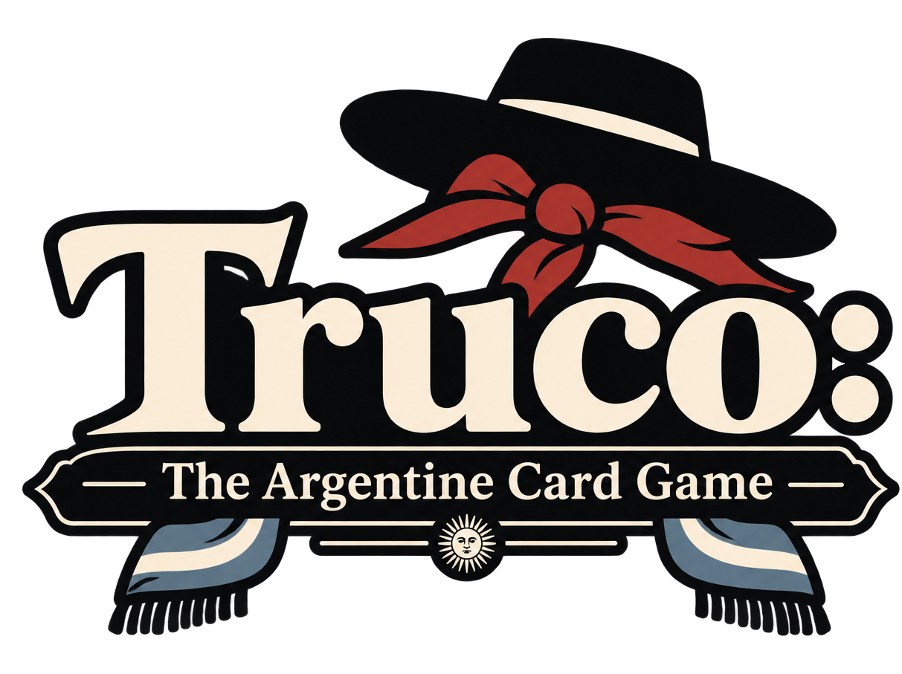

<p align="center">
  
</p>

A 1v1 version of the **Argentine Truco** card game in Python against an AI, separating the game logic (`src/core.py`) from a **Tkinter** graphical interface (`src/gui.py`).
Final project for the **Code in Place X** course (Stanford University).

## About Argentine Truco

**Truco** is a fast-paced Argentine trick-taking and bluffing card game where winning is as much about reading calls (*cantos*) and bluffing as holding strong cards.

## Rules (15-Point Match)

- **Deck:** A 40-card Spanish deck (`1`–`7` and `10`–`12`, no `8`s or `9`s) in **Spades**, **Clubs**, **Gold**, and **Cups**.
- **Trick Hierarchy (Highest to Lowest):**
  `1 Spades` > `1 Clubs` > `7 Spades` > `7 Gold` > `3s` > `2s` > `1 Gold / 1 Cups` > `12` > `11` > `10` > `7 Cups / 7 Clubs` > `6` > `5` > `4` (suit does not break ties on equal numbers).
- **Rounds & Tricks:** Each player gets **3 cards** and alternates **Hand (*Mano*)** (first to act in the round). Best of **3 tricks** wins the round:
  - Tie in trick 1: winner of trick 2 wins the round.
  - Tie in trick 2: winner of trick 1 wins the round.
  - Tie in trick 3: **Hand (*Mano*)** wins the round.
- **Envido (Before any card is played):**
  - Two same-suit cards: `20 + sum of the two highest cards` (`10`, `11`, and `12` count as `0`), or the highest single card value otherwise.
  - Refusal (*No quiero*) value:
    - Direct call (`envido`, `real envido`, or `falta envido`): **1 point**.
    - Second step in chain (e.g., `envido` -> `real envido` or `envido` -> `envido`): **2 points**.
    - Third step in chain (e.g., `envido` -> `real envido` -> `falta envido`): **3 points**.
- **Truco Ladder:**
  - No call = **1 pt** | `Truco` = **2 pts** | `Retruco` = **3 pts** | `Vale Cuatro` = **4 pts**.

## Run

```bash
python -m src.gui
```

</br>

*A Code in Place X final project. Looking forward to building more on this foundation.*